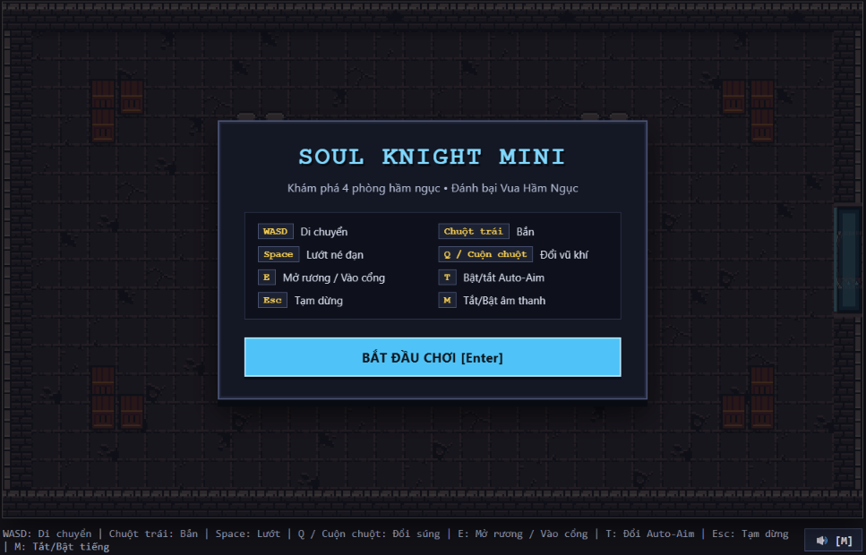
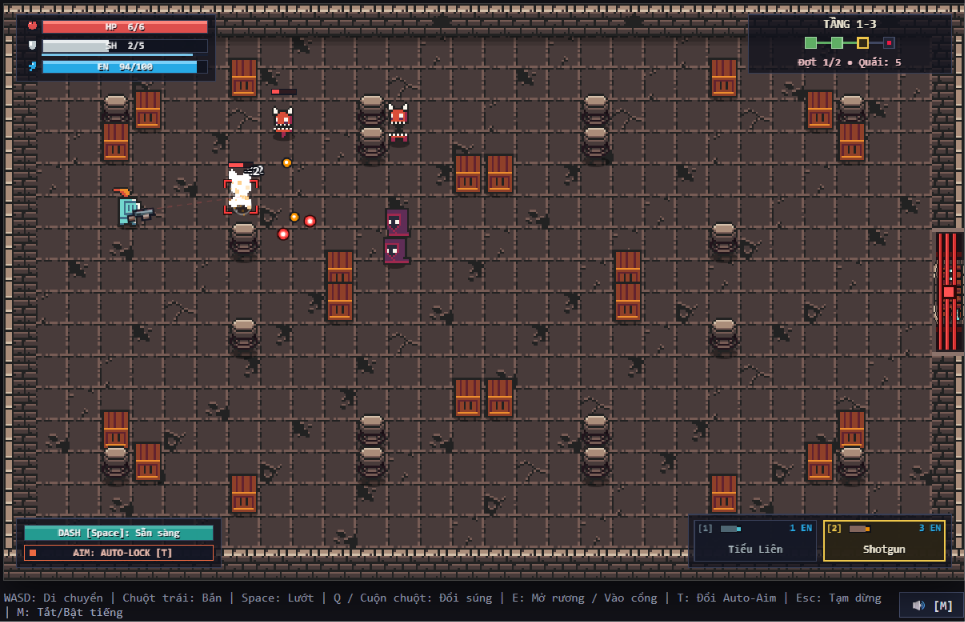
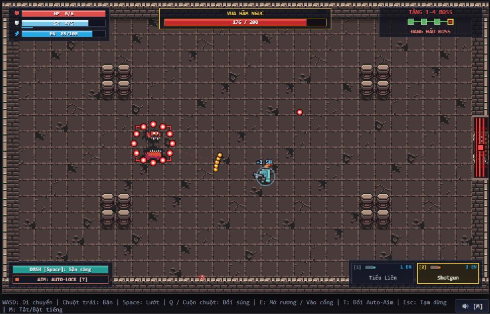

# Soul Knight Mini


Tựa game hành động bắn súng hầm ngục Pixel Art 2D góc nhìn từ trên xuống lấy cảm hứng từ *Soul Knight*. Dự án được xây dựng hoàn toàn bằng **HTML5 Canvas** (`960×576`, lưới `30×18` ô `32×32` px, tắt làm mờ pixel) và **JavaScript thuần (ES Modules)** — **không sử dụng bất kỳ thư viện hay framework ngoài nào**.

> 🎮 [](https://khoicorn2005-ui.github.io/soul-knight-mini/)  
> Chơi trực tiếp trên trình duyệt tại: **https://khoicorn2005-ui.github.io/soul-knight-mini/**

---

## Ảnh chụp màn hình

| Start Menu | Chiến đấu hầm ngục | Đấu Boss cuối (1-4) |
| :---: | :---: | :---: |
|  |  |  |
| *Màn hình Start Menu* | *Chiến đấu trong hầm ngục* | *Đấu Boss cuối — Vua Hầm Ngục (1-4)* |

---

## Tính năng nổi bật

- **4 phòng hầm ngục nối tiếp (`1-1`, `1-2`, `1-3`, `1-4 BOSS`):** Bố cục cột đá và thùng gỗ chắn đạn đa dạng qua từng tầng, hỗ trợ cơ chế di chuyển trượt tường mượt mà.
- **Hệ thống chỉ số chuẩn Soul Knight:** `6` Máu (HP), `5` Giáp (Shield hấp thụ sát thương trước HP và tự hồi từng điểm sau `4 giây` không dính đòn), `100` Năng lượng (EN) cùng kỹ năng **Lướt bất tử (`Space`)** có thời gian hồi chiêu.
- **Kho vũ khí & nhặt chiến lợi phẩm:** 4 loại vũ khí (**Súng Lục** `0 EN`, **Shotgun**, **Tiểu Liên**, **Pháp Trượng**), mang tối đa `2` vũ khí cùng lúc, mở Rương vũ khí sau khi dọn sạch phòng và nhặt Ngọc năng lượng rơi ra từ quái vật/Boss.
- **2 chế độ ngắm linh hoạt:** Ngắm bắn thủ công theo con trỏ chuột hoặc bật chế độ tự khóa mục tiêu (**Auto-Aim**) chuyển đổi nhanh bằng phím `T`.
- **Boss cuối "Vua Hầm Ngục" (Phòng 1-4):** Sở hữu thanh máu lớn cùng 3 chiêu thức xen kẽ (bắn đạn vòng tròn, bắn tia đuổi, lướt áp sát) và bước vào **Pha Cuồng Nộ** khi máu xuống dưới `50%`.
- **Đồ họa Pixel Art, âm thanh 8-bit & Game Feel:** Hoạt ảnh nhân vật 4 khung hình sắc nét (`imageSmoothingEnabled = false`), hệ thống âm thanh 8-bit hỗ trợ tắt/bật nhanh (`M`), cùng đầy đủ hiệu ứng chiến đấu (tia lửa đầu nòng, giật vũ khí, rung màn hình, số sát thương nhảy lên và hiệu ứng vỡ giáp).
- **HUD 4 góc & 4 màn hình hoàn chỉnh:** Giao diện HUD tự làm mờ (`Dynamic Opacity`) khi nhân vật đi ngang qua, kết hợp trọn bộ luồng màn hình **Start Menu**, **Pause** (`Esc` và tự động tạm dừng khi chuyển tab/mất focus), **Victory** và **Game Over** kèm bảng thống kê lượt chơi.

---

## Phím điều khiển

| Phím | Chức năng |
| :--- | :--- |
| `W` `A` `S` `D` / `Phím mũi tên` | Di chuyển 8 hướng (hỗ trợ trượt tường) |
| `Chuột trái` | Ngắm và bắn (giữ để bắn liên thanh) |
| `Space` | Lướt né đạn (bất tử trong lúc lướt, có hồi chiêu) |
| `Q` / `Cuộn chuột` | Đổi qua lại giữa 2 vũ khí đang mang |
| `E` | Mở Rương vũ khí / Bước vào Cổng dịch chuyển sang phòng kế tiếp |
| `T` | Chuyển đổi chế độ ngắm Thủ công / Auto-Aim |
| `M` | Tắt / Bật âm thanh 8-bit (hoặc bấm nút loa bên dưới màn hình) |
| `Esc` | Tạm dừng / Tiếp tục trò chơi |
| `Enter` | Bắt đầu nhanh từ Start Menu hoặc Chơi lại tại Victory / Game Over |

---

## Hướng dẫn chạy game trên máy cá nhân

1. **Clone mã nguồn về máy:**

```bash
git clone https://github.com/khoicorn2005-ui/soul-knight-mini.git
cd soul-knight-mini
```

2. **Chạy qua máy chủ HTTP cục bộ (Local Server):**
   - **Cách 1 (Khuyên dùng — VS Code):** Cài đặt extension **Live Server**, nhấp chuột phải vào file `index.html` và chọn **Open with Live Server**.
   - **Cách 2 (Python):** Mở terminal tại thư mục gốc dự án và chạy:

```bash
python -m http.server 8000
```

Sau đó mở trình duyệt và truy cập `http://localhost:8000`.

> **Lưu ý:** Cần chạy game qua Live Server hoặc local server thay vì mở trực tiếp file `index.html` qua giao thức `file://`, bởi trình duyệt sẽ chặn tải JavaScript **ES Modules** (`import/export`), hình ảnh và tệp âm thanh do chính sách bảo mật **CORS**.

---

## Cấu trúc dự án

```text
soul-knight-mini/
├── index.html                    # Khung Canvas 960x576 và giao diện 4 màn hình
├── style.css                     # Giao diện nền tối, CSS pixel-rendering & overlay
├── GDD.md                        # Tài liệu thiết kế game (Game Design Document)
├── ROADMAP.md                    # Lộ trình phát triển dự án
├── README.md                     # Tài liệu hướng dẫn phiên bản v1.0.0
├── js/
│   ├── main.js                   # Vòng lặp chính, máy trạng thái & điều phối màn chơi
│   ├── map.js                    # Bản đồ lưới 30x18, 4 bố cục phòng & va chạm gạch
│   ├── player.js                 # Nhân vật Hiệp sĩ, Giáp tự hồi, Lướt & hoạt ảnh
│   ├── weapon.js                 # 4 loại vũ khí, AimSystem (Thủ công / Auto-Aim)
│   ├── bullet.js                 # Quản lý đạn, đạn đuổi & va chạm swept substeps
│   ├── enemy.js                  # Quái cận chiến/đánh xa, đợt quái & lực tách nhóm
│   ├── boss.js                   # Boss Vua Hầm Ngục 3 chiêu thức & Pha Cuồng Nộ
│   ├── loot.js                   # Rương vũ khí, Ngọc năng lượng & Cổng dịch chuyển
│   ├── ui.js                     # HUD 4 góc (Dynamic Opacity) & ScreenManager
│   ├── assets.js                 # Bộ nạp toàn bộ sprite Pixel Art hầm ngục
│   ├── audio.js                  # Hệ thống phát hiệu ứng âm thanh 8-bit & Mute
│   └── vfx.js                    # Tia lửa đầu nòng, rung màn hình & số sát thương
└── assets/
    ├── audio/                    # Hiệu ứng âm thanh 8-bit (.wav)
    │   ├── chest.wav
    │   ├── dash.wav
    │   ├── explosion.wav
    │   ├── hit.wav
    │   ├── hurt.wav
    │   ├── pickup.wav
    │   ├── shoot.wav
    │   └── shotgun.wav
    ├── images/
    │   └── dungeon/
    │       └── frames/           # Sprite gạch nền, vật cản, nhân vật & hiệu ứng
    └── screenshots/              # Ảnh chụp màn hình cho README
        ├── menu.png
        ├── combat.png
        └── boss.png
```

---

## Ghi nguồn tài nguyên

- **Đồ họa Pixel Art hầm ngục:** [16x16 DungeonTileset II](https://0x72.itch.io/dungeontileset-ii) bởi **0x72** trên Itch.io (Giấy phép **CC0**).
- **Hiệu ứng âm thanh 8-bit:** Tạo bằng [jsfxr](https://sfxr.me).
